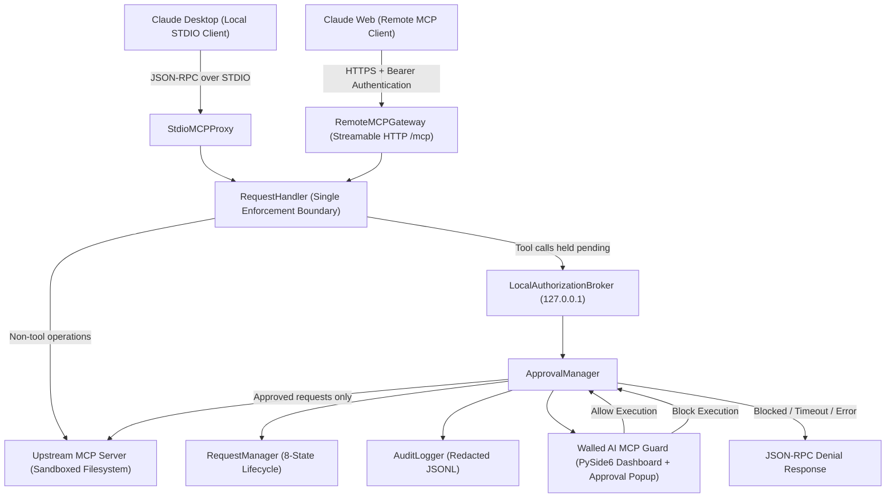

# Walled AI MCP Guard

**Real-Time MCP Communication Monitoring & User Authorization System for Windows**

Walled AI MCP Guard is a Python desktop security application that intercepts Model Context Protocol (MCP) `tools/call` requests in real time and requires explicit human authorization through an always-on-top desktop popup before any upstream MCP tool can execute.

Built with the **official MCP Python SDK (`mcp 2.3.0`)**, **PySide6 (`6.12.0`)**, **asyncio**, and **FastAPI/Uvicorn**, it operates as a genuine intermediary MCP proxy (STDIO for local clients like Claude Desktop and Streamable HTTP for remote clients) with strict **fail-closed** security guarantees.

---

## Integration Status & Compatibility

| Client / Transport | Status | Verified Evidence |
| :--- | :--- | :--- |
| **MCP STDIO Proxy (`StdioMCPProxy`)** | Verified End-to-End | Tested over real Windows STDIO pipes against the built-in safe test server and official `@modelcontextprotocol/server-filesystem` (`npx`). |
| **PySide6 Desktop Guard & Local Broker** | Verified End-to-End | Live Windows testing of authenticated local broker communication, always-on-top Allow/Block popups, concurrent requests, timeouts and shutdown cancellation. |
| **Remote Streamable HTTP Gateway (`RemoteMCPGateway`)** | Verified End-to-End | Tested using official `mcp.client.streamable_http` against FastAPI/Uvicorn with the desktop approval workflow. |
| **Claude Desktop (Live GUI on Windows)** | Verified End-to-End | Live integration using the official filesystem MCP server. Approved directory listing and file creation; blocked file creation; verified blocked file was not created; checked dashboard counters and audit logs. |
| **Claude Web (Live `claude.ai`)** | Verified End-to-End | Live remote integration through Cloudflare Quick Tunnel using authenticated Bearer token and Streamable HTTP. Approved `list_allowed_directories` through the Windows approval popup and received the successful directory listing in Claude Web. Blocked `write_file`; Claude received the denial response, and PowerShell confirmed the blocked file did not exist (`Test-Path` returned `False`). |

---

## 1. Problem Statement

AI assistants and agents increasingly invoke external tools through the **Model Context Protocol (MCP)** — reading files, writing code, querying databases and interacting with external APIs.

Because tool descriptions and arguments can be influenced by untrusted context, such as prompt injection in documents or web pages, allowing silent and unmonitored tool execution creates significant security risks:

- Unauthorized file creation, modification or exfiltration.
- Silent invocation of sensitive tools without user visibility.
- Lack of per-request audit trails with secret redaction.
- Absence of fail-closed protection when a security controller crashes or exits.

**Walled AI MCP Guard** addresses these risks by placing a human-in-the-loop authorization proxy directly in the MCP communication path.

---

## 2. Key Features

- **Genuine MCP Protocol Proxy (`mcp 2.3.0`):** Acts as an intermediary MCP server/client proxy forwarding initialization, capability negotiation, tools, resources, prompts, completion, logging, ping and notifications while preserving JSON-RPC 2.0 request IDs.
- **Single Enforcement Boundary (`RequestHandler`):** Every `tools/call` request is intercepted before upstream execution. Blocked, timed-out, cancelled or failed authorizations never reach the upstream tool.
- **Always-on-Top Authorization Popup (`PySide6`):** Displays MCP server name, tool name, request IDs, timestamp, tool description and redacted JSON parameters with explicit Allow Execution and Block Execution controls.
- **Security Dashboard & Windows System Tray:** Provides real-time protection status, MCP proxy connection status, request counters, recent activity history, monitoring controls and minimize-to-tray behavior.
- **Strict 8-State Request Lifecycle:** Tracks requests through `PENDING`, `APPROVED`, `BLOCKED`, `EXECUTING`, `COMPLETED`, `FAILED`, `TIMED_OUT` and `CANCELLED`.
- **Redacted JSONL Audit Logging:** Maintains structured audit records with recursive credential redaction for passwords, tokens, secrets, authorization headers, API keys and other sensitive values.
- **Authenticated Local IPC Broker:** Loopback-only (`127.0.0.1`) FastAPI/Uvicorn broker with per-session Bearer tokens and host/origin validation.
- **Remote MCP Streamable HTTP Gateway:** Authenticated `/mcp` endpoint routing remote MCP tool calls through the same request authorization handler and desktop approval popup.
- **Fail-Closed Security:** Authorization failures, broker errors, timeouts and explicit denials prevent upstream tool execution.

---

## 3. Supported Architectures

### Local Claude Desktop Architecture (STDIO Proxy)

Claude Desktop launches `StdioMCPProxy`:

`python -m app.proxy.stdio_proxy --use-desktop-guard`

The proxy communicates with the configured upstream MCP server over Windows STDIO pipes and authorizes every tool call through the running Walled AI MCP Guard desktop application using authenticated local IPC.

### Remote Claude Web Architecture (Streamable HTTP)

Claude Web runs in Anthropic's cloud infrastructure and cannot directly launch a local STDIO subprocess.

To support remote access, `RemoteMCPGateway` (`app/proxy/http_gateway.py`) exposes an authenticated MCP Streamable HTTP endpoint at `/mcp`.

The gateway can be exposed through an HTTPS reverse proxy or Cloudflare Tunnel. Every remote tool call is routed through the same authorization handler and the local Windows desktop approval interface.

The live Claude Web integration was verified using a Cloudflare Quick Tunnel, Bearer authentication and the desktop authorization broker.

### System Architecture Diagram



See [docs/ARCHITECTURE.md](docs/ARCHITECTURE.md) for detailed sequence, threading and state-machine diagrams.

---

## 4. MCP Request Lifecycle, Allow/Block & Concurrency

### Request Lifecycle

1. **Interception:** The downstream MCP client sends a `tools/call` request. `RequestHandler` validates the tool name and JSON arguments.
2. **Registration (`PENDING`):** An `InterceptedRequest` is created with a unique internal ID, original JSON-RPC request ID, server name, tool name, description and parameters.
3. **User Prompt:** `ApprovalManager` creates an independent `asyncio.Future` and notifies `GuardController`, which opens an always-on-top approval popup on the Qt main thread.
4. **Allow Behavior:** Clicking **Allow Execution** transitions the request to `APPROVED`, claims execution exactly once, forwards the tool call upstream and records its result.
5. **Block Behavior:** Clicking **Block Execution** returns a structured JSON-RPC denial response. The upstream tool is never invoked.
6. **Timeout and Shutdown:** Expired approvals, monitoring shutdown and broker/callback errors fail closed and prevent unauthorized execution.

### Concurrency & Failure Handling

- **Concurrent Requests:** Each request has its own authorization future and independent request lifecycle.
- **Responsive GUI:** A dedicated background thread runs the asyncio event loop while PySide6 operates on the Qt main thread.
- **Fault Tolerance:** Upstream crashes, malformed JSON-RPC frames, unavailable brokers, invalid tokens, audit-log errors and desktop shutdown with pending requests are handled through fail-closed behavior.

---

## 5. Live Integration Verification

### Claude Desktop

The following scenarios were verified on Windows:

| Test | Action | Result |
| :--- | :--- | :--- |
| Directory listing | `list_allowed_directories` | Approved |
| File creation | `write_file` → `claude_approved_test.txt` | Approved; file verified on disk |
| Blocked file creation | `write_file` → `claude_blocked_test.txt` | Blocked; file not created |

Dashboard counters and audit history were also checked during the live integration test.

### Claude Web

The following scenarios were verified using the remote Streamable HTTP gateway:

| Test | Action | Result |
| :--- | :--- | :--- |
| Remote connection | Claude Web connected to the MCP endpoint | Successful |
| Authentication | Bearer token authentication | Successful |
| Directory listing | `list_allowed_directories` | Approved through Windows popup |
| Remote approval | Desktop authorization broker | Successful |
| Remote denial | `write_file` | Blocked through Windows popup |
| File verification | `Test-Path .\sandbox_files\claude_web_blocked_test.txt` | `False` |

The remote approval and denial tests demonstrate that Claude Web tool calls are subject to the same human authorization boundary as local Claude Desktop calls.

**Remote demonstration note:** The live test used Cloudflare Quick Tunnel. Quick Tunnel URLs are temporary and are intended for testing, not production availability.

---

## 6. Testing

The automated test suite was executed successfully.

```text
107 passed
0 failed
0 skipped
0 errors
```

The test suite covers MCP proxy behavior, request lifecycle management, approval handling, broker communication, HTTP gateway behavior, audit logging, concurrency and fail-closed scenarios.

---

## 7. Documentation & Evidence

Project documentation:

- [Architecture Documentation](docs/ARCHITECTURE.md)
- [Demo Script](docs/DEMO_SCRIPT.md)

Screenshots:

**Desktop integration**
- `docs/screenshots/dashboard.png`
- `docs/screenshots/approval_popup.png`

**Claude Web integration**
- `docs/screenshots/claude-web/01-claude-web-approved.png`
- `docs/screenshots/claude-web/02-walled-ai-approval-popup.png`
- `docs/screenshots/claude-web/03-claude-web-blocked.png`
- `docs/screenshots/claude-web/04-desktop-dashboard-after-broker-restart.png`

---

## 8. Security Considerations

- All tool calls pass through a centralized authorization boundary.
- The gateway requires Bearer authentication.
- The local authorization broker binds to loopback (`127.0.0.1`).
- Host and Origin validation help prevent DNS rebinding and unauthorized cross-origin access.
- Sensitive values are redacted from audit records.
- Requests fail closed when authorization cannot be completed.
- Cloudflare Quick Tunnel is suitable for temporary demonstrations; production deployment should use a stable HTTPS endpoint, secure credential management and an appropriately configured authentication strategy.
- Never commit live Bearer tokens, API keys or other credentials to source control.

---

## 9. Technology Stack

| Area | Technology |
| :--- | :--- |
| Language | Python |
| MCP Protocol | Official MCP Python SDK (`mcp 2.3.0`) |
| Desktop UI | PySide6 |
| Async Runtime | asyncio |
| HTTP Gateway | FastAPI, Uvicorn |
| HTTP Client | httpx |
| Transport | STDIO, Streamable HTTP |
| Data Format | JSON-RPC 2.0 |
| Audit Logging | JSONL |
| Remote Testing | Cloudflare Quick Tunnel |
| Automated Testing | pytest |

---

## 10. Repository

**GitHub:** [Walled AI MCP Guard](https://github.com/panuganti0211/walled-ai-mcp-guard)

