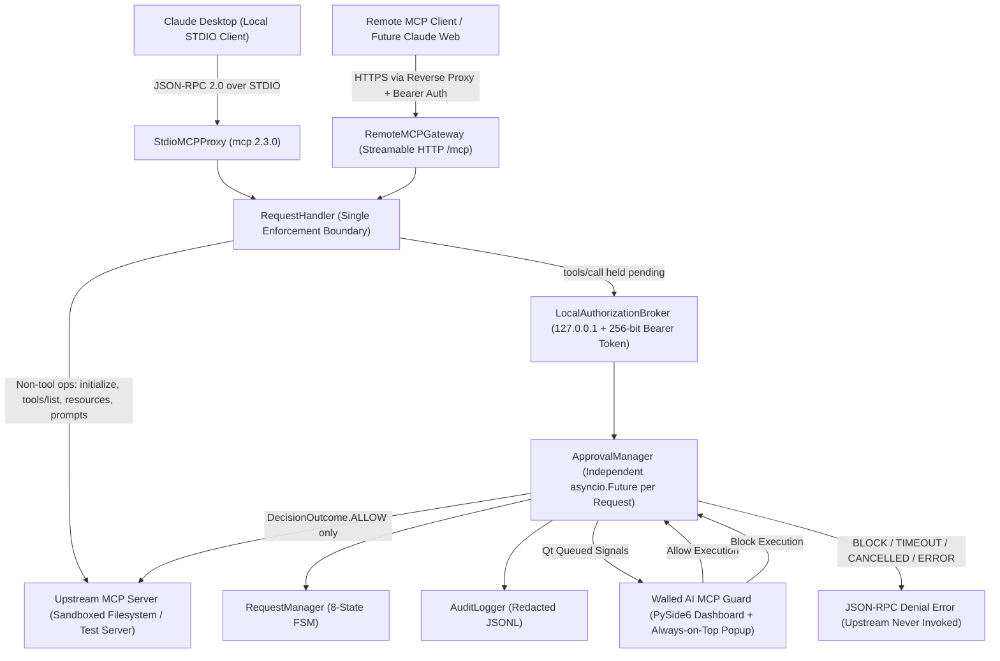
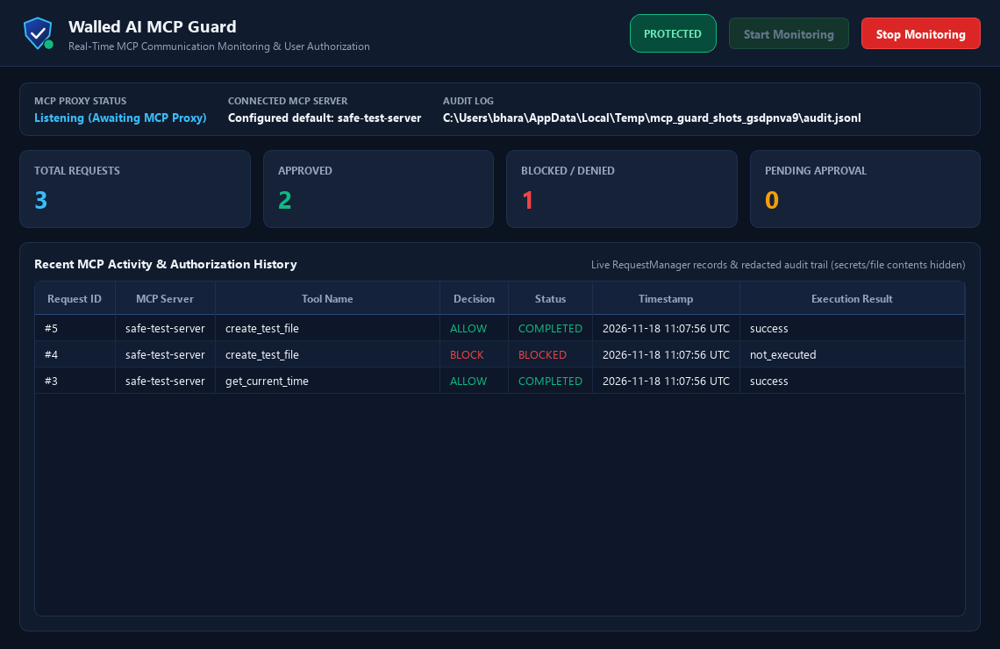
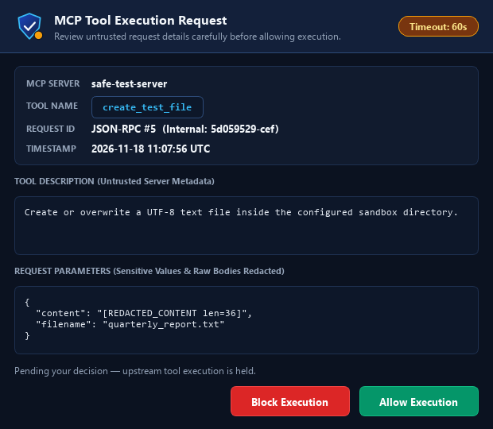

# Walled AI MCP Guard

**Real-Time MCP Communication Monitoring & User Authorization System for Windows**

Walled AI MCP Guard is a production-structured Python desktop security application that intercepts Model Context Protocol (MCP) `tools/call` requests in real time and requires explicit human authorization in an always-on-top desktop popup before any upstream MCP tool can execute.

Built with the **official MCP Python SDK (`mcp 2.3.0`)**, **PySide6 (`6.12.0`)**, **asyncio**, and **FastAPI/Uvicorn**, it operates as a genuine intermediary MCP proxy (STDIO for local clients like Claude Desktop, and Streamable HTTP for remote authenticated clients) with strict **fail-closed** security guarantees.

---

## Integration Status & Honest Compatibility Disclosure

| Client / Transport | Status | Verified Evidence |
| :--- | :--- | :--- |
| **MCP STDIO Proxy (`StdioMCPProxy`)** | **Verified End-to-End** | Tested over real Windows STDIO pipes against both the built-in safe test server and official `@modelcontextprotocol/server-filesystem` (`npx`). |
| **PySide6 Desktop Guard & Local Broker** | **Verified End-to-End** | Tested live with 3-process STDIO -> authenticated `127.0.0.1` broker -> always-on-top Allow/Block popups, multi-popup concurrency, timeouts, and shutdown cancellation. |
| **Remote Streamable HTTP Gateway (`RemoteMCPGateway`)** | **Verified Locally** | Local Streamable HTTP integration tests passed using official `mcp.client.streamable_http` against live FastAPI/Uvicorn + desktop popup approval flow. |
| **Claude Desktop (Live GUI)** | **Pending Live Manual Test** | Claude Desktop is not currently installed on the development machine. Backup-first configurator, `@modelcontextprotocol/server-filesystem`, and exact foreign-`cwd` launch tests passed, but **live GUI Tests A–E inside Claude Desktop have not yet been executed**. |
| **Claude Web (Live `claude.ai`)** | **Pending Public HTTPS & OAuth 2.1 Deployment** | Local Streamable HTTP tests passed, but **live Claude Web connector verification has not yet been performed** and requires a public HTTPS domain plus OAuth 2.1 Protected Resource Metadata (RFC 9728). |

---

## 1. Problem Statement

AI desktop assistants and agents increasingly invoke external tools through the **Model Context Protocol (MCP)** — reading files, writing code, querying databases, and interacting with external APIs. Because tool descriptions and arguments can be influenced by untrusted context (e.g., prompt injection in documents or web pages), allowing silent, unmonitored tool execution creates high-impact security risks:

- Unauthorized file creation, modification, or exfiltration.
- Silent invocation of sensitive tools without explicit user visibility.
- Lack of per-request audit trails with secret redaction.
- Absence of fail-closed protection when a security controller crashes or exits.

**Walled AI MCP Guard** solves this by placing an unbypassable, fail-closed human-in-the-loop authorization proxy directly in the MCP protocol path.

---

## 2. Key Features

- **Genuine MCP Protocol Proxy (`mcp 2.3.0`):** Acts as a true intermediary MCP server/client proxy forwarding `initialize`, capability negotiation, `tools/list`, `resources/*`, `prompts/*`, `completion`, `logging`, `ping`, and notifications while preserving JSON-RPC 2.0 request IDs.
- **Single Enforcement Boundary (`RequestHandler`):** Every `tools/call` request is intercepted before upstream execution; blocked, timed-out, cancelled, or erroring authorizations **never** reach the upstream tool.
- **Always-on-Top Authorization Popup (`PySide6`):** Displays MCP server name, tool name, JSON-RPC & internal request IDs, UTC timestamp, untrusted tool description, and redacted JSON parameters with explicit **Allow Execution** / **Block Execution** controls and live countdown timer.
- **Dedicated Security Dashboard & Windows System Tray:** Real-time protection status (`PROTECTED` / `STOPPED`), live MCP proxy/server connection status, live KPI counters backed by `RequestManager`, deduplicated recent activity history, Start/Stop monitoring controls, and minimize-to-tray behavior.
- **Strict 8-State Request Lifecycle (`RequestManager` & `ApprovalManager`):** Independent `asyncio.Future` per request (`PENDING`, `APPROVED`, `BLOCKED`, `EXECUTING`, `COMPLETED`, `FAILED`, `TIMED_OUT`, `CANCELLED`), duplicate-decision prevention, duplicate-execution prevention, configurable timeout rejection, and graceful shutdown cancellation.
- **Redacted JSONL Audit Logging (`AuditLogger`):** Structured append-only JSONL audit trail with recursive key/value credential redaction (`password`, `token`, `secret`, `authorization`, `api_key`, JWT/Bearer/PEM patterns) and raw file content stripping.
- **Authenticated Local IPC Broker (`LocalAuthorizationBroker`):** Loopback-only (`127.0.0.1`) FastAPI/Uvicorn broker with per-session 256-bit Bearer tokens, protected Windows owner-only DACL token files, strict `Host`/`Origin` DNS-rebinding defenses, and token rotation on restart.
- **Remote MCP Streamable HTTP Gateway (`RemoteMCPGateway`):** Authenticated `/mcp` Streamable HTTP gateway routing remote tool calls through the exact same `RequestHandler` and desktop approval popup.

---

## 3. Supported Architectures

### Local Claude Desktop Architecture (STDIO Proxy)
Claude Desktop spawns `StdioMCPProxy` (`python -m app.proxy.stdio_proxy --use-desktop-guard`) as its configured MCP server over Windows STDIO pipes. The proxy spawns the explicitly configured upstream MCP server (e.g., sandbox-restricted `@modelcontextprotocol/server-filesystem`) via `stdio_client`, and authorizes every `tools/call` against the running Walled AI MCP Guard desktop application over authenticated `127.0.0.1` IPC.

### Remote MCP Gateway Architecture (Streamable HTTP)
Because **Claude Web** runs in Anthropic's cloud infrastructure, it cannot connect to a local STDIO subprocess. `RemoteMCPGateway` (`app/proxy/http_gateway.py`) exposes an authenticated **MCP Streamable HTTP** endpoint (`/mcp`) designed to sit behind a public HTTPS reverse proxy (Caddy, Nginx, or Cloudflare Tunnel) and routes every remote `tools/call` through the exact same `RequestHandler` and either the desktop PySide6 approval popup (`--use-desktop-guard`) or an injected `ApprovalManager`.

### System Architecture Diagram



*(See [docs/ARCHITECTURE.md](docs/ARCHITECTURE.md) for detailed sequence, threading, and state-machine diagrams.)*

---

## 4. MCP Request Lifecycle, Allow/Block & Concurrency

### Request Lifecycle
1. **Interception:** Downstream client sends `tools/call` with JSON-RPC `request_id`. `RequestHandler` validates the tool name and strict JSON arguments (`INVALID_PARAMS` before authorization if malformed).
2. **Registration (`PENDING`):** `InterceptedRequest` is created with a UUID `internal_id`, original `jsonrpc_request_id`, `server_name`, `tool_name`, cached `tool_description`, and deep-cloned parameters, registered in `RequestManager`, and logged to `AuditLogger`.
3. **User Prompt:** `ApprovalManager` holds an independent `asyncio.Future` and notifies `GuardController`, which opens an always-on-top `ApprovalPopup` on the Qt main thread.
4. **Allow Behavior:** Clicking **Allow Execution** invokes `ApprovalManager.approve(internal_id)` -> `APPROVED` -> atomic single-shot `EXECUTING` claim -> forwards `call_tool(...)` upstream -> transitions to `COMPLETED` (or `FAILED` if upstream returns `is_error` / raises) -> returns exact upstream result preserving JSON-RPC `request_id`.
5. **Block / Timeout / Shutdown Behavior (Fail-Closed):** Clicking **Block Execution** (`-32003`), exceeding the approval timeout (`-32001`), stopping monitoring / exiting (`-32004`), or encountering any broker/callback error (`-32005`) transitions to a terminal state (`BLOCKED`, `TIMED_OUT`, `CANCELLED`, `FAILED`), logs the redacted event, returns a structured JSON-RPC error to the client, and **never** calls `upstream.call_tool(...)`.

### Concurrency & Failure Handling
- **Verified up to 50 Simultaneous Requests:** `mcp 2.3.0`'s `JSONRPCDispatcher` spawns an `anyio` task per non-`initialize` request; `ApprovalManager` isolates every request with its own `asyncio.Future`; `MainWindow` cascades concurrent popups independently by `internal_id`.
- **Responsive GUI (`AsyncioWorkerThread`):** A dedicated background thread runs a native Windows `asyncio.ProactorEventLoop` while PySide6 runs solely on the Qt main thread, preventing GUI freezes and deadlocks.
- **Fault Tolerance:** Upstream crashes, malformed JSON-RPC frames, unavailable brokers, rotated/invalid tokens, unwritable audit log directories, abrupt proxy kills, and desktop shutdown with pending requests are all tested to fail closed without unauthorized execution.

---

## 5. Security Controls

- **Strict Fail-Closed Default:** Missing authorizer, stopped desktop app, invalid token, duplicate `internal_id` replay, callback crash, or timeout always denies execution.
- **Zero Shell Execution & Strict Config Validation:** `app/config.py` forbids shell interpreters (`cmd.exe`, `powershell.exe`, `pwsh`, `sh`, `bash`, `wscript`, `cscript`), shell metacharacters (`;`, `&`, `|`, `$`, `` ` ``, `<`, `>`), unknown config fields, and unconfigured/disabled servers.
- **Explicit Filesystem Sandbox Confinement:** `resolve_sandbox_path()` rejects `..` traversal, absolute/drive-qualified paths, UNC paths, null bytes, and escaping symlinks; upstream filesystem MCP servers are restricted exclusively to `sandbox_files`.
- **Untrusted Input Rendering Hygiene:** All popup labels enforce `Qt.TextFormat.PlainText` (preventing HTML/RichText injection), strip control characters, and pass parameters through `redact_sensitive_data()`.
- **Local IPC Hardening:** `LocalAuthorizationBroker` binds strictly to `127.0.0.1`, validates URLs via strict `urlparse` (blocking `@evil.com` userinfo tricks), writes the 256-bit Bearer token atomically with Windows protected owner-only DACLs (`current user + SYSTEM`), refuses symlinks, enforces strict `Host` and `Origin` checks, disables Swagger/OpenAPI endpoints, and rotates/invalidates tokens on stop/restart.
- **Recursive Secret & Content Redaction:** `AuditLogger` recursively scrubs credential keys (`password`, `token`, `secret`, `authorization`, `api_key`, etc.), secret value patterns (Bearer/Basic/JWT/`sk-`/`ghp_`/`AIza`/PEM keys), and raw file bodies (`content`, `body`, `payload`, `data`, long strings).

---

## 6. Technology Stack

| Layer | Technology | Verified Installed Version |
| :--- | :--- | :--- |
| Language & Runtime | Python (64-bit Windows) | `3.14.7` (supports `3.11+`) |
| MCP Protocol SDK | Official `mcp` Python SDK (`mcp-types`) | `2.3.0` |
| Desktop GUI | PySide6 (Qt6) | `6.12.0` |
| Concurrency | `asyncio` + `anyio` | `anyio 4.16.0` |
| IPC Broker & Remote Gateway | FastAPI + Uvicorn + `httpx` | `fastapi 0.163.2`, `uvicorn 0.54.0`, `httpx 0.28.1` |
| Validation | Pydantic v2 | `2.14.3` |
| Automated Testing | `pytest` + `pytest-asyncio` | `pytest 9.2.0`, `pytest-asyncio 1.5.0` |
| Upstream Example Server | Node.js / `npx` (`@modelcontextprotocol/server-filesystem`) | Node `v24.18.0`, `npx 11.16.0` |

---

## 7. Project Folder Structure

```text
walled-ai-mcp-guard/
├── app/
│   ├── __init__.py
│   ├── config.py                    # Strict Pydantic config loader & sandbox path resolver
│   ├── main.py                      # AsyncioWorkerThread, GuardController & GUI entrypoint
│   ├── authorization/
│   │   ├── approval_manager.py      # Async per-request ApprovalManager (PySide6-independent)
│   │   ├── ipc_broker.py            # Authenticated 127.0.0.1 broker & fail-closed client
│   │   └── request_manager.py       # Strict 8-state RequestManager finite-state machine
│   ├── models/
│   │   └── request.py               # RequestStatus, AuthorizationDecision, ToolAuthorizer
│   ├── monitoring/
│   │   └── audit_logger.py          # Redacted structured JSONL AuditLogger
│   ├── proxy/
│   │   ├── http_gateway.py          # Authenticated Streamable HTTP Remote MCP Gateway
│   │   ├── request_handler.py       # Single tools/call enforcement & forwarding boundary
│   │   └── stdio_proxy.py           # Official MCP SDK 2.3.0 STDIO proxy
│   └── ui/
│       ├── approval_popup.py        # Always-on-top PySide6 authorization popup
│       ├── main_window.py           # Dark-navy cybersecurity dashboard
│       ├── system_tray.py           # Windows system tray integration
│       └── theme.py                 # Dark-navy QSS stylesheet & vector shield icons
├── config/
│   └── servers.example.json         # Safe sandboxed example server configuration
├── docs/
│   ├── ARCHITECTURE.md              # Deep-dive architecture & Mermaid diagrams
│   ├── DEMO_SCRIPT.md               # 3-5 minute demo recording plan & submission checklist
│   └── screenshots/
│       ├── dashboard.png            # Captured live dashboard screenshot
│       └── approval_popup.png       # Captured live approval popup screenshot
├── logs/
│   └── .gitkeep                     # Runtime JSONL logs excluded by .gitignore
├── scripts/
│   ├── capture_screenshots.py       # Reproducible real-MCP UI screenshot script
│   ├── configure_claude_desktop.py  # Backup-first Claude Desktop Windows configurator
│   └── demo_mcp_client.py           # Real MCP STDIO interactive test client
├── tests/
│   ├── test_approval.py             # ApprovalManager, RequestManager & audit tests
│   ├── test_blocking.py             # Dedicated zero-bypass blocking tests
│   ├── test_claude_desktop_config.py# Config backup & foreign-cwd launch tests
│   ├── test_concurrent_requests.py  # 10/25/50-request & GUI load stress tests
│   ├── test_failures.py             # Crash, malformed RPC, token & shutdown tests
│   ├── test_http_gateway.py         # Real Streamable HTTP gateway tests
│   ├── test_mcp_server.py           # Safe sandboxed local test MCP server
│   ├── test_proxy.py                # Core STDIO proxy & sandbox tests
│   ├── test_security.py             # ACL, DNS-rebinding, shell-injection & secret tests
│   └── test_ui.py                   # Offscreen PySide6 & E2E desktop tests
├── .gitignore
├── pytest.ini
├── README.md
├── requirements.txt
└── run.py                           # Desktop application root launcher
```

---

## 8. Setup & Installation (Windows)

### 1. Python & Node.js Prerequisites
- Install **Python 3.11+** (64-bit) from [python.org](https://www.python.org/downloads/windows/). Verify:
  ```powershell
  python --version
  ```
  *(If Windows Store App Execution Aliases interfere with bare `python`, reference your concrete Python binary directly, e.g. `C:\Users\<user>\AppData\Local\Python\pythoncore-3.14-64\python.exe`.)*
- Install **Node.js LTS** (includes `npx`) if using `@modelcontextprotocol/server-filesystem`.

### 2. Create Virtual Environment & Install Dependencies
```powershell
cd D:\walled-ai-mcp-guard
python -m venv .venv
D:\walled-ai-mcp-guard\.venv\Scripts\python.exe -m pip install -r requirements.txt
```

> **Windows Application Control Note:** Always run tools via the signed interpreter (`D:\walled-ai-mcp-guard\.venv\Scripts\python.exe -m pytest`, `python.exe run.py`) rather than pip-generated `.venv\Scripts\*.exe` wrappers, which Windows Application Control policies may block.

### 3. Safe Filesystem MCP Server Configuration
Copy `config/servers.example.json` to `config/servers.json` (gitignored) or generate it automatically via `scripts/configure_claude_desktop.py`. Never configure a drive root (`C:\`) or user profile root; always scope `@modelcontextprotocol/server-filesystem` strictly to an explicit directory such as `D:\walled-ai-mcp-guard\sandbox_files`.

---

## 9. Running Walled AI MCP Guard

### Launch the Desktop Application
```powershell
cd D:\walled-ai-mcp-guard
D:\walled-ai-mcp-guard\.venv\Scripts\python.exe run.py
```
The dark-navy dashboard opens in **PROTECTED** mode and adds a shield icon to the Windows system tray.

### Quick Interactive End-to-End Test (Without Claude Desktop)
In a second PowerShell terminal while `run.py` is running:
```powershell
# Test ALLOW (click "Allow Execution" in the popup):
D:\walled-ai-mcp-guard\.venv\Scripts\python.exe scripts\demo_mcp_client.py --tool create_test_file --filename approved_demo.txt --content "Approved by user"

# Verify file was created:
Get-Content "$env:TEMP\walled_ai_mcp_guard_demo\approved_demo.txt"

# Test BLOCK (click "Block Execution" in the popup):
D:\walled-ai-mcp-guard\.venv\Scripts\python.exe scripts\demo_mcp_client.py --tool create_test_file --filename blocked_demo.txt --content "MUST_NOT_EXIST"

# Verify blocked file was NEVER created (must print False):
Test-Path "$env:TEMP\walled_ai_mcp_guard_demo\blocked_demo.txt"
```

---

## 10. Claude Desktop Configuration (Windows)

> **Status Disclosure:** Live GUI verification inside Claude Desktop is **pending** until Claude Desktop is installed on the host machine and Tests A–E below are run.

### Step 1: Install Claude Desktop
Download from [https://claude.ai/download](https://claude.ai/download) (or `winget install Anthropic.Claude`), launch once, and sign in.

### Step 2: Locate Configuration File
- Standard installer: `%APPDATA%\Claude\claude_desktop_config.json`
- Microsoft Store / MSIX package: `%LOCALAPPDATA%\Packages\Claude_*\LocalCache\Roaming\Claude\claude_desktop_config.json`

### Step 3: Run Safe Backup-First Configurator
Preview changes first:
```powershell
D:\walled-ai-mcp-guard\.venv\Scripts\python.exe scripts\configure_claude_desktop.py --dry-run
```
Apply safely (automatically backs up any existing file and preserves unrelated `mcpServers`):
```powershell
D:\walled-ai-mcp-guard\.venv\Scripts\python.exe scripts\configure_claude_desktop.py --server filesystem-sandbox
```

### Step 4: Start Walled AI & Fully Restart Claude Desktop
1. Start Walled AI MCP Guard (`D:\walled-ai-mcp-guard\.venv\Scripts\python.exe run.py`).
2. Right-click Claude in the Windows system tray -> **Quit**, then relaunch Claude Desktop.
3. Run **Tests A–E** (Tool Discovery, Allow, Block + marker absence, Multi-request independence, and Shutdown fail-closed).

---

## 11. Remote MCP Gateway Configuration (Streamable HTTP)

> **Status Disclosure:** Local Streamable HTTP integration tests have **passed** against the official MCP Python SDK 2.3.0 client. Live **Claude Web** integration is **pending** public HTTPS deployment and OAuth 2.1 connector verification.

### Running Locally Behind a Reverse Proxy
1. Start Walled AI MCP Guard (`run.py`) so remote requests trigger your desktop approval popups.
2. Generate a strong ephemeral Bearer token (never hardcode tokens):
   ```powershell
   $env:MCP_GUARD_GATEWAY_TOKEN = D:\walled-ai-mcp-guard\.venv\Scripts\python.exe -c "import secrets; print(secrets.token_urlsafe(32))"
   ```
3. Launch the gateway bound strictly to `127.0.0.1`:
   ```powershell
   D:\walled-ai-mcp-guard\.venv\Scripts\python.exe -m app.proxy.http_gateway `
     --config config\servers.json `
     --server filesystem-sandbox `
     --host 127.0.0.1 `
     --port 8443 `
     --use-desktop-guard `
     --allowed-host mcp.yourdomain.com `
     --allowed-origin https://claude.ai
   ```

### HTTPS & OAuth 2.1 Production Requirements
- **Public HTTPS Mandatory:** Terminate TLS in front of `127.0.0.1:8443` using **Caddy**, **Nginx + Let's Encrypt**, or **Cloudflare Tunnel**. Never expose plain HTTP directly on the public internet.
- **OAuth 2.1 for Native Claude Web Connectors:** Current gateway enforces RFC 6750 Bearer token authentication (`401 Unauthorized` + `WWW-Authenticate: Bearer`). Native Claude Web OAuth "Connect" onboarding additionally requires RFC 9728 Protected Resource Metadata (`/.well-known/oauth-protected-resource`) and an OAuth 2.1 Authorization Server / `TokenVerifier`.

---

## 12. Automated Tests & Verified Results

Run the full test suite:
```powershell
D:\walled-ai-mcp-guard\.venv\Scripts\python.exe -m pytest
```

### Actual Final Test Results
- **Total:** **107 passed, 0 failed, 0 skipped, 0 errors** (54 `mcp 2.3.0` legacy STDIO deprecation notices for `roots`/`progress`, preserved for older MCP clients).
- **Coverage across 9 test modules:**
  - `tests/test_proxy.py` (`25`): Config validation, sandbox traversal blocking, real STDIO initialization, tool/resource/prompt forwarding, allow, block, fail-closed, 3-process STDIO pipe E2E.
  - `tests/test_approval.py` (`13`): 8-state FSM, invalid transitions, duplicate rejection, timeout, shutdown cancellation, recursive secret redaction, unwritable audit log isolation, zero PySide6 coupling.
  - `tests/test_ui.py` (`8`): Dashboard initialization, system tray, plain-text popup safety, thread separation, real 3-process STDIO -> Broker -> PySide6 Allow/Block/Multi-Popup/Timeout/Shutdown tests.
  - `tests/test_blocking.py` (`7`): Per-call independence, duplicate `internal_id` replay fail-closed, all non-`ALLOW` outcomes blocked.
  - `tests/test_concurrent_requests.py` (`7`): **10, 25, and 50 simultaneous MCP requests**, mixed timeouts, 20 rapid calls, multi-client shared broker, 12-popup GUI stress test.
  - `tests/test_failures.py` (`7`): Upstream startup & mid-execution `os._exit(1)` crash survival, malformed JSON-RPC/arguments, unavailable broker, rotated/expired tokens, desktop close mid-request, abrupt proxy kill.
  - `tests/test_security.py` (`32`): Loopback URL parser, Windows owner-only DACLs, DNS-rebinding `Host` & `Origin` blocks, shell-injection blocking, circular/deep redaction, `.gitignore` & secret scan.
  - `tests/test_claude_desktop_config.py` (`2`): Backup-first config merge & foreign-`cwd` Scenarios A–E.
  - `tests/test_http_gateway.py` (`6`): Real Streamable HTTP auth (`401`/`413`/`421`), initialize/discovery/allow/block/timeout/concurrency, redacted audit, and desktop PySide6 popup flow.

---

## 13. Screenshots

Captured from live real-MCP runs using [scripts/capture_screenshots.py](file:///d:/walled-ai-mcp-guard/scripts/capture_screenshots.py):

### Main Security Dashboard


### Always-on-Top Authorization Popup


---

## 14. Known Limitations

1. **Claude Desktop Live GUI Testing Pending:** Not yet executed on the development host because Claude Desktop is not installed yet.
2. **Claude Web Live Deployment Pending:** Local Streamable HTTP tests pass; live `claude.ai` integration requires public HTTPS hosting and OAuth 2.1 Protected Resource Metadata (RFC 9728).
3. **Same-User Windows Threat Model:** Owner-only DACLs protect the broker token file from other local user accounts and network/browser attackers, not from malware already running under the same Windows user account.
4. **In-Memory Request Store:** Live dashboard request state is held in memory per session (durable history is reloaded safely from `logs/audit.jsonl`).

---

## 15. Troubleshooting

| Issue | Cause | Fix |
| :--- | :--- | :--- |
| `pytest.exe` blocked by Windows Application Control | Unsigned pip `.exe` shim blocked by Windows policy | Always use `D:\walled-ai-mcp-guard\.venv\Scripts\python.exe -m pytest`. |
| `ModuleNotFoundError: No module named 'app'` in Claude Desktop logs | Claude Desktop launches Python from its own app directory | Ensure `"env": {"PYTHONPATH": "D:\\walled-ai-mcp-guard", "PYTHONUTF8": "1"}` is present in `claude_desktop_config.json`. |
| Every tool call immediately fails with `-32005` | Walled AI desktop app is not running or monitoring is **STOPPED** | Launch `run.py` and confirm the status badge reads **PROTECTED**. |
| Claude Desktop does not show new MCP server | Claude minimized to tray instead of quitting | Right-click Claude in the Windows notification area -> **Quit**, then relaunch. |
| Gateway exits with code `2` | `MCP_GUARD_GATEWAY_TOKEN` missing or shorter than 32 chars | Set `MCP_GUARD_GATEWAY_TOKEN` to a 32+ character random secret. |

---

## 16. Future Improvements

- Native OAuth 2.1 Authorization Server & RFC 9728 Protected Resource Metadata (`mcp.server.auth`) for turnkey Claude Web onboarding.
- Optional Windows Named Pipe IPC transport (replacing loopback HTTP for local proxy-to-desktop IPC).
- Authenticated web/mobile approval console for headless cloud deployments of `RemoteMCPGateway`.
- Per-tool risk classification badges (read-only vs. write/destructive) and policy rules (always-block denylists without ever enabling unsafe auto-allow defaults).
- Code-signed Windows MSIX/EXE installer bundling Python + PySide6.
