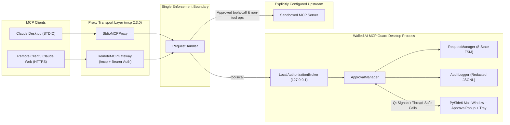
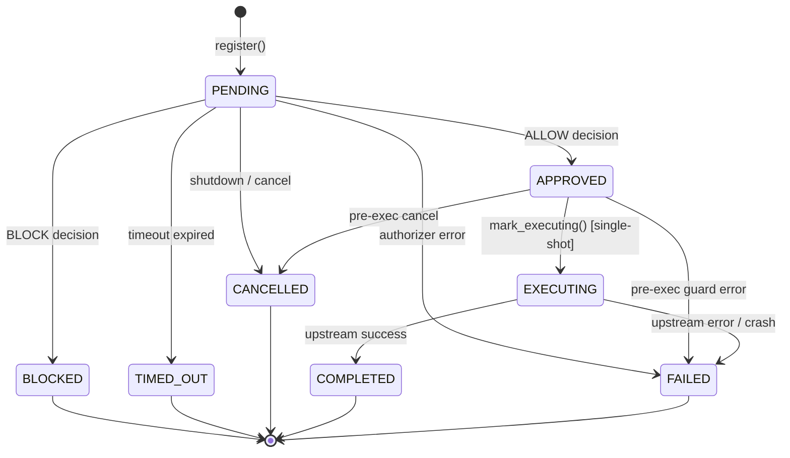
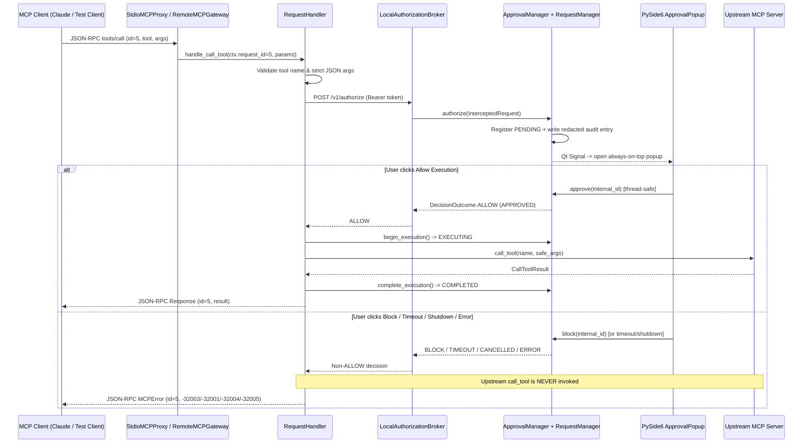

# Walled AI MCP Guard — Architecture & Security Design

This document describes the internal architecture, security boundaries, concurrency model, and failure semantics of **Walled AI MCP Guard**.

---

## 1. High-Level MCP Proxy Topology

Walled AI MCP Guard implements a **genuine intermediary MCP Server/Client Proxy** built on the official **MCP Python SDK (`mcp 2.3.0`)**:

- **MCP Host / Client:**
  - **Claude Desktop on Windows:** Fully verified live client communicating over Windows STDIO pipes via `mcp.server.stdio.stdio_server`.
  - **Interactive Test Client:** `scripts/demo_mcp_client.py` using official `ClientSession` over STDIO for testing.
  - **Remote MCP Clients / Claude Web:** Authenticated Streamable HTTP clients connecting to `RemoteMCPGateway` at `/mcp` (tested locally; designed for public HTTPS reverse proxying via Caddy/Nginx/Cloudflare Tunnel and RFC 9728 OAuth 2.1 metadata).
- **MCP Guard Proxy Layer:**
  - `StdioMCPProxy` (`app/proxy/stdio_proxy.py`): Serves downstream over `mcp.server.stdio.stdio_server` (`Server`) and connects upstream via `mcp.client.stdio.stdio_client` (`ClientSession`).
  - `RemoteMCPGateway` (`app/proxy/http_gateway.py`): Serves downstream over FastAPI + `StreamableHTTPSessionManager` at `/mcp` and connects upstream via `stdio_client` (`ClientSession`).
- **Upstream MCP Server:** Only explicitly configured, validated servers in `config/servers.json` (e.g., sandbox-restricted `@modelcontextprotocol/server-filesystem` via `npx` or `tests.test_mcp_server`).

---

## 2. Core Component Responsibilities

### `StdioMCPProxy` (`app/proxy/stdio_proxy.py`)
- Launches only validated `StdioServerParameters` (no shell execution; sanitized environment preserving `PYTHONPATH`/`PYTHONUTF8` while stripping host secrets).
- Initializes upstream first (`await upstream_session.initialize()`), then mirrors upstream `ServerCapabilities` and `NotificationOptions` onto the downstream `mcp.server.lowlevel.server.Server`.
- Reserves `stdout` strictly for JSON-RPC 2.0 frames; all diagnostic logging routes to `stderr`.
- Forwards upstream server-to-client notifications (`tools/list_changed`, `resources/list_changed`, `resources/updated`, `prompts/list_changed`, `progress`, `logging`).

### `RemoteMCPGateway` (`app/proxy/http_gateway.py`)
- Exposes an authenticated Streamable HTTP endpoint (`/mcp`) as a raw Starlette ASGI `Route` inside FastAPI (avoiding `307` redirects on `POST /mcp`).
- Enforces mandatory Bearer token authentication (`MCP_GUARD_GATEWAY_TOKEN` >= 32 chars, constant-time `hmac.compare_digest`, `401` + RFC 6750 `WWW-Authenticate`), sliding-window per-client rate limiting (`429`), 1 MiB body size cap (`413`), and SDK `TransportSecuritySettings` DNS-rebinding `Host`/`Origin` checks before any request reaches `StreamableHTTPSessionManager`.
- Connects to either an injected `ApprovalManager` or the desktop `LocalAuthorizationBroker` via `RemoteBrokerAuthorizer`.
- **Implementation & Testing Status:**
  - *Implemented:* Fully implemented in `app/proxy/http_gateway.py` using official MCP Python SDK 2.3.0 `StreamableHTTPSessionManager`.
  - *Locally Verified:* All 6 automated tests in `tests/test_http_gateway.py` passed using official `mcp.client.streamable_http`.
  - *Hosted Claude Web Integration:* Not yet tested live against hosted `claude.ai`.
  - *Deployment Requirements (from code inspection):* Requires public HTTPS reverse proxy hosting (Caddy, Nginx, Cloudflare Tunnel) for TLS termination and an OAuth 2.1 Authorization Server providing RFC 9728 Protected Resource Metadata at `/.well-known/oauth-protected-resource`.

### `RequestHandler` (`app/proxy/request_handler.py`) — Single Enforcement Boundary
- **Security Invariant:** `RequestHandler.handle_call_tool` is the **only** code path in the entire codebase permitted to invoke `upstream.call_tool(...)`.
- Validates tool names and strict JSON-serializable arguments (`INVALID_PARAMS` before authorization).
- Caches tool metadata from `tools/list` so popups display tool descriptions (explicitly marked untrusted).
- Evaluates `_authorize_fail_closed()` -> requires an explicit `AuthorizationDecision(outcome=DecisionOutcome.ALLOW)` before acquiring `_exec_lock`, claiming single-shot execution via `begin_execution`, and forwarding upstream.
- Preserves original JSON-RPC `ctx.request_id` end-to-end and forwards non-tool operations (`list_tools`, `resources/*`, `prompts/*`, `completion`, `logging`, `ping`) without unnecessary modification.

### `ApprovalManager` (`app/authorization/approval_manager.py`)
- PySide6-independent asynchronous coordinator implementing `ToolAuthorizer`.
- Creates one independent `asyncio.Future[AuthorizationDecision]` per intercepted request, keyed by `internal_id` and guarded by `threading.RLock`.
- Rejects duplicate `internal_id` replays fail-closed.
- Exposes cross-thread-safe `approve(internal_id)` and `block(internal_id)` (using `loop.call_soon_threadsafe(...)` when invoked from the Qt GUI thread) with strict one-shot enforcement (`DuplicateDecisionError` on repeats).
- Enforces configurable `timeout_seconds` (`TIMED_OUT`, never auto-approves) and graceful `shutdown()` (resolves all pending futures with `DecisionOutcome.CANCELLED` so waiting handlers send clean denials with zero orphaned tasks).

### `RequestManager` (`app/authorization/request_manager.py`)
- Thread-safe finite-state machine enforcing valid lifecycle transitions and providing live dashboard metrics (`get_stats()`) and recent history (`list_recent()`).

### `LocalAuthorizationBroker` & `RemoteBrokerAuthorizer` (`app/authorization/ipc_broker.py`)
- Bridges external proxy processes (spawned by Claude Desktop or CLI) to the persistent PySide6 desktop GUI.
- Binds strictly to `127.0.0.1` on an OS-assigned port with a per-session 256-bit random Bearer token written atomically to `%LOCALAPPDATA%\WalledAIMCPGuard\broker_runtime.json`.
- Applies a protected Windows owner-only DACL (`current user SID + SYSTEM`, inheritance stripped) and refuses symlinks on read/write.
- Validates broker URLs strictly via `urllib.parse.urlparse` (blocking `@evil.com` userinfo injection), enforces strict `Host` header regex and `Origin` header rejection (`403`), rotates tokens on restart, and invalidates the active token immediately on `stop()`.
- Chains per-`internal_id` execution event HTTP notifications in strict order (`begin` -> `complete`/`fail`).

### PySide6 UI & Threading Model (`app/main.py`, `app/ui/*`)
- **Dedicated `AsyncioWorkerThread`:** Runs a native Windows `ProactorEventLoop` on a daemon thread, keeping native IOCP subprocess/socket behavior for `mcp 2.3.0` / `anyio` and avoiding `qasync` compatibility risks on Python 3.14 + PySide6 6.12.
- **Qt Main Thread:** Runs `MainWindow`, `ApprovalPopup` dialogs, and `GuardSystemTray`. Never calls `asyncio.run()` or `time.sleep()`.
- **Cross-Thread Bridge (`GuardController`):** Asyncio callbacks emit Qt queued signals (`pending_request_arrived`, `request_updated`, `request_resolved`, `monitoring_changed`, `proxy_status_changed`); UI button clicks invoke thread-safe `ApprovalManager.approve()` / `block()`.

### `AuditLogger` (`app/monitoring/audit_logger.py`)
- Thread-safe JSONL logger built on Python `logging.FileHandler` (`propagate=False`).
- Recursively redacts sensitive keys (`password`, `token`, `secret`, `authorization`, `api_key`, `private_key`, etc.), secret value patterns (Bearer/Basic/JWT/`sk-`/`ghp_`/`AIza`/PEM headers), and raw payload/content keys (`content`, `body`, `data`, long strings).
- Isolates disk/permission failures to `stderr` warnings without crashing or altering authorization decisions.

---

## 3. End-to-End Request Sequence Diagram

---

## 4. Security Boundaries & Failure Handling Summary

| Threat / Failure Mode | Defense / Enforced Behavior |
| :--- | :--- |
| Desktop GUI closed or stopped | Runtime token file deleted + token cleared; proxy fails closed (`-32005`). |
| Unauthenticated / wrong / expired token | Rejected with `HTTP 401` before reaching MCP/approval logic; proxy fails closed. |
| Browser DNS rebinding / CSRF against localhost | Strict `Host` validation + `Origin` rejection (`403` / `421`). |
| Untrusted HTML/script in tool description or args | Strictly rendered with `Qt.TextFormat.PlainText`; sensitive params redacted. |
| Path traversal / symlink escape in filesystem tools | `resolve_sandbox_path()` rejects `..`, absolute/UNC/drive paths, null bytes, and escaping symlinks. |
| Shell command injection in `servers.json` | Direct process spawn (`StdioServerParameters`, no shell) + strict interpreter/metacharacter denylist. |
| Upstream crash mid-execution (`os._exit(1)`) | Caught cleanly; recorded as `FAILED`; blocked crash calls never reach upstream. |
| Audit log directory unwritable | Error isolated to `stderr`; never crashes or approves blocked requests. |
| Duplicate button click or duplicate `internal_id` | Buttons disable on first click; `RequestManager` & `ApprovalManager` reject replays. |
