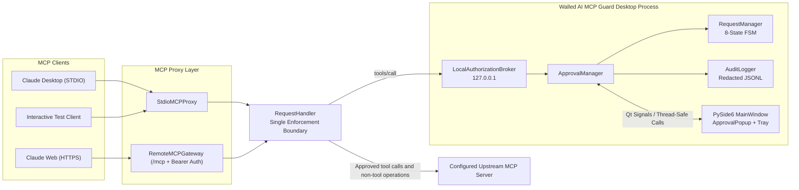
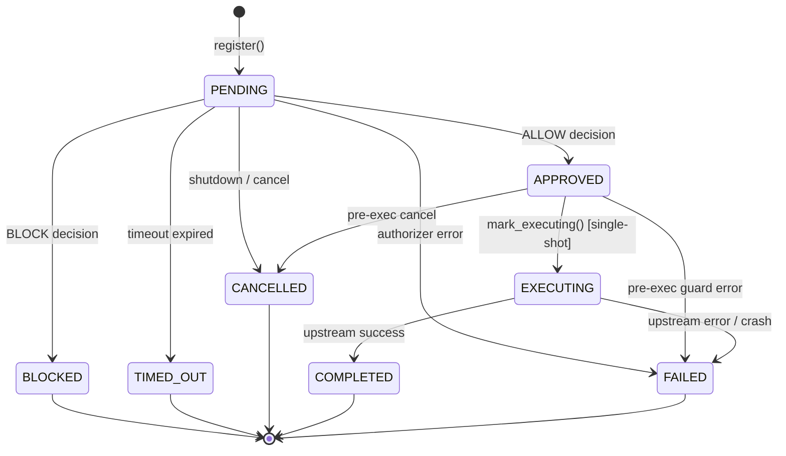
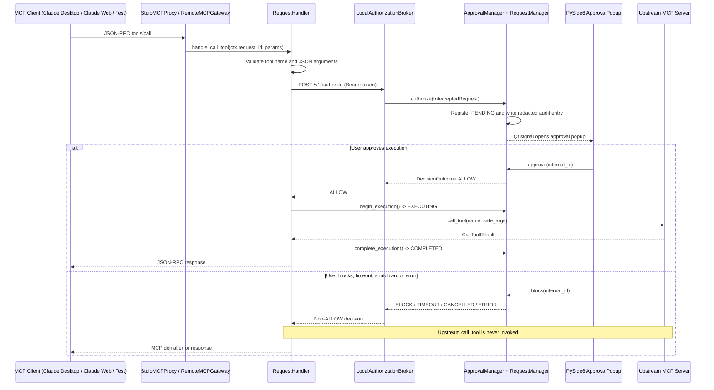

# Walled AI MCP Guard — Architecture & Security Design

This document describes the internal architecture, security boundaries, concurrency model, and failure semantics of **Walled AI MCP Guard**, including verified integrations with Claude Desktop and Claude Web.

---

## 1. High-Level MCP Proxy Topology

Walled AI MCP Guard implements a genuine intermediary MCP Server/Client Proxy using the official **MCP Python SDK (`mcp 2.3.0`)**.

- **MCP Host / Client:**
  - **Claude Desktop on Windows:** Verified live using Windows STDIO pipes through `mcp.server.stdio.stdio_server`.
  - **Claude Web:** Verified live using authenticated Streamable HTTP through the remote MCP gateway and a temporary Cloudflare Quick Tunnel.
  - **Interactive Test Client:** `scripts/demo_mcp_client.py`, using the official `ClientSession` over STDIO.

- **MCP Guard Proxy Layer:**
  - `StdioMCPProxy` (`app/proxy/stdio_proxy.py`): Serves downstream over `mcp.server.stdio.stdio_server` (`Server`) and connects upstream through `mcp.client.stdio.stdio_client` (`ClientSession`).
  - `RemoteMCPGateway` (`app/proxy/http_gateway.py`): Serves downstream through FastAPI and `StreamableHTTPSessionManager` at `/mcp`, and connects upstream through `stdio_client` (`ClientSession`).

- **Authorization Layer:**
  - `RequestHandler` provides the single enforcement boundary for tool execution.
  - `LocalAuthorizationBroker` connects external proxy processes to the running desktop application.
  - `ApprovalManager` and `RequestManager` coordinate approval decisions and request lifecycle state.

- **Upstream MCP Server:** Only explicitly configured and validated servers in `config/servers.json`, including the sandbox-restricted filesystem MCP server and test servers.

### Architecture diagram

---

## 2. Core Component Responsibilities

### `StdioMCPProxy` (`app/proxy/stdio_proxy.py`)

- Launches only validated `StdioServerParameters`, without shell execution.
- Sanitizes the subprocess environment while preserving required variables such as `PYTHONPATH` and `PYTHONUTF8`.
- Initializes the upstream session before exposing downstream capabilities.
- Mirrors upstream `ServerCapabilities` and `NotificationOptions` onto the downstream MCP server.
- Reserves `stdout` strictly for JSON-RPC 2.0 frames; diagnostic logging goes to `stderr`.
- Forwards upstream server-to-client notifications, including tool, resource, prompt, progress, and logging notifications.

### `RemoteMCPGateway` (`app/proxy/http_gateway.py`)

- Exposes an authenticated Streamable HTTP endpoint at `/mcp`.
- Uses FastAPI and the official MCP SDK `StreamableHTTPSessionManager`.
- Uses a raw Starlette ASGI route to avoid unwanted `307` redirects on `POST /mcp`.
- Enforces mandatory Bearer token authentication using `MCP_GUARD_GATEWAY_TOKEN`.
- Requires a gateway token of at least 32 characters and uses constant-time `hmac.compare_digest` comparison.
- Rejects unauthenticated requests with HTTP `401` and an RFC 6750 `WWW-Authenticate` response.
- Applies sliding-window per-client rate limiting (`429`) and a 1 MiB request body size limit (`413`).
- Applies MCP transport security checks for DNS rebinding, including `Host` and `Origin` validation.
- Connects to either an injected `ApprovalManager` or the desktop `LocalAuthorizationBroker` through `RemoteBrokerAuthorizer`.

**Implementation and verification status:**

- **Implemented:** Uses the official MCP Python SDK 2.3.0 `StreamableHTTPSessionManager`.
- **Automated verification:** All 6 tests in `tests/test_http_gateway.py` passed using the official `mcp.client.streamable_http` client.
- **Claude Web integration:** Verified live through the authenticated remote gateway.
- **Approval verification:** A Claude Web `list_allowed_directories` request displayed the native Walled AI approval popup. After approval, Claude Web received the configured sandbox directory.
- **Denial verification:** A Claude Web `write_file` request was blocked through the Walled AI approval popup. Claude received the denial response, and PowerShell confirmed that the requested file did not exist.
- **Desktop broker verification:** The gateway successfully communicated with the desktop authorization broker; heartbeat requests returned HTTP `200 OK`.

**Remote demonstration deployment:**

The live Claude Web demonstration used a temporary Cloudflare Quick Tunnel to expose the local gateway over HTTPS. The gateway remained bound to `127.0.0.1` locally and accepted the configured tunnel hostname and `https://claude.ai` origin.

The Quick Tunnel was used for demonstration and verification. Its hostname is temporary and is not a permanent production endpoint.

The verified Claude Web connector configuration used Bearer token authentication with a manually configured authorization header. A stable production deployment would require a persistent HTTPS endpoint, appropriate network controls, secure secret management, and deployment-specific authentication and access policies.

### `RequestHandler` (`app/proxy/request_handler.py`) — Single Enforcement Boundary

- **Security invariant:** `RequestHandler.handle_call_tool` is the only code path permitted to invoke `upstream.call_tool(...)`.
- Validates tool names and strict JSON-serializable arguments before authorization.
- Caches tool metadata from `tools/list` so approval popups can display tool descriptions, which are treated as untrusted input.
- Calls `_authorize_fail_closed()` and requires an explicit `AuthorizationDecision(outcome=DecisionOutcome.ALLOW)`.
- Acquires `_exec_lock` and claims single-shot execution through `begin_execution` before forwarding an approved request.
- Preserves the original JSON-RPC `ctx.request_id` end-to-end.
- Forwards supported non-tool operations, including `list_tools`, resources, prompts, completion, logging, and ping.

### `ApprovalManager` (`app/authorization/approval_manager.py`)

- PySide6-independent asynchronous coordinator implementing `ToolAuthorizer`.
- Creates one independent `asyncio.Future[AuthorizationDecision]` per intercepted request.
- Keys requests by `internal_id` and protects shared state using `threading.RLock`.
- Rejects duplicate `internal_id` replays fail-closed.
- Exposes thread-safe `approve(internal_id)` and `block(internal_id)` operations.
- Uses `loop.call_soon_threadsafe(...)` when decisions originate from the Qt GUI thread.
- Enforces configurable authorization timeouts. Expired requests become `TIMED_OUT` and are never automatically approved.
- Supports graceful shutdown, resolving pending futures with `DecisionOutcome.CANCELLED` to prevent orphaned authorization tasks.

### `RequestManager` (`app/authorization/request_manager.py`)

- Implements a thread-safe finite-state machine for request lifecycle management.
- Enforces valid state transitions.
- Provides live dashboard metrics through `get_stats()` and recent request history through `list_recent()`.

### `LocalAuthorizationBroker` and `RemoteBrokerAuthorizer` (`app/authorization/ipc_broker.py`)

- Bridges external proxy processes to the persistent PySide6 desktop GUI.
- Binds strictly to `127.0.0.1` using an OS-assigned port.
- Generates a per-session 256-bit random Bearer token.
- Writes runtime connection details atomically to `%LOCALAPPDATA%\WalledAIMCPGuard\broker_runtime.json`.
- Applies a protected Windows owner-only DACL for the current user SID and SYSTEM, with inheritance stripped.
- Refuses symlinks during runtime configuration reads and writes.
- Validates broker URLs using `urllib.parse.urlparse`, blocking userinfo injection such as `@evil.com`.
- Enforces strict `Host` header validation and `Origin` rejection.
- Rotates tokens on restart and invalidates the active token immediately on `stop()`.
- Chains per-request execution event notifications in strict order: `begin` followed by `complete` or `fail`.

### PySide6 UI and Threading Model (`app/main.py`, `app/ui/*`)

- **Dedicated `AsyncioWorkerThread`:** Runs a native Windows `ProactorEventLoop` on a daemon thread, preserving native IOCP subprocess and socket behavior for MCP SDK 2.3.0 and AnyIO.
- **Qt Main Thread:** Runs `MainWindow`, `ApprovalPopup` dialogs, and `GuardSystemTray`.
- The Qt main thread does not call `asyncio.run()` or `time.sleep()`.
- **Cross-Thread Bridge (`GuardController`):** Asyncio callbacks emit Qt queued signals, including `pending_request_arrived`, `request_updated`, `request_resolved`, `monitoring_changed`, and `proxy_status_changed`.
- UI button clicks invoke thread-safe `ApprovalManager.approve()` and `block()` methods.

### `AuditLogger` (`app/monitoring/audit_logger.py`)

- Thread-safe JSONL logger built on Python `logging.FileHandler` with `propagate=False`.
- Recursively redacts sensitive keys such as `password`, `token`, `secret`, `authorization`, `api_key`, and `private_key`.
- Redacts sensitive value patterns including Bearer, Basic, JWT, `sk-`, `ghp_`, `AIza`, and PEM headers.
- Redacts raw payload/content keys such as `content`, `body`, and `data`, as well as long strings.
- Isolates disk and permission failures to `stderr` warnings without crashing or changing authorization decisions.

---

## 3. End-to-End Request Sequence

---

## 4. Security Boundaries and Failure Handling

| Threat / Failure Mode | Defense / Enforced Behavior |
| :--- | :--- |
| Desktop GUI closed or stopped | Runtime token file deleted and token cleared; proxy fails closed (`-32005`). |
| Unauthenticated, wrong, or expired gateway token | Rejected with HTTP `401` before reaching MCP or approval logic. |
| Browser DNS rebinding / CSRF against localhost | Strict `Host` validation and `Origin` checks (`403` / `421`). |
| Untrusted HTML or scripts in tool descriptions or arguments | Rendered using `Qt.TextFormat.PlainText`; sensitive parameters redacted. |
| Path traversal / symlink escape in filesystem tools | `resolve_sandbox_path()` rejects traversal, absolute/UNC/drive paths, null bytes, and escaping symlinks. |
| Shell command injection in `servers.json` | Direct process spawning through `StdioServerParameters`, without shell execution, plus interpreter and metacharacter validation. |
| Upstream crash during execution | Failure is caught and recorded as `FAILED`; blocked requests never reach upstream. |
| Audit log directory unwritable | Error isolated to `stderr`; authorization decisions are not changed. |
| Duplicate button click or duplicate `internal_id` | Buttons disable after the first decision; `RequestManager` and `ApprovalManager` reject replays. |
| Authorization timeout | Request transitions to `TIMED_OUT`; no automatic approval occurs. |
| Desktop broker unavailable | Remote authorization fails closed; the gateway does not bypass desktop approval. |

---

## 5. Live Integration Verification

The following integrations were tested against running clients rather than relying only on mocked tests.

### Claude Desktop — Windows

- Connected to the local Walled AI MCP Guard STDIO server.
- Approved `list_allowed_directories` through the native desktop approval popup.
- Approved a `write_file` request and verified the expected file content.
- Blocked a separate `write_file` request through the approval popup.
- Verified that the blocked file was not created.
- Confirmed dashboard counters and audit logging.

### Claude Web — Remote Streamable HTTP

- Connected Claude Web to the authenticated remote MCP gateway using a temporary Cloudflare Quick Tunnel.
- Verified that gateway heartbeat requests reached the local desktop authorization broker successfully.
- Approved `list_allowed_directories` through the native Walled AI desktop approval popup.
- Verified that Claude Web received the sandbox directory path.
- Blocked a `write_file` request through the same native approval popup.
- Verified that Claude Web received the denial response.
- Confirmed with PowerShell that the blocked file did not exist.

### Automated tests

The project test suite completed with:

- **107 passed**
- **0 failed**
- **0 skipped**
- **0 errors**

The test run reported 54 SDK deprecation warnings.

---

## 6. Evidence Screenshots

The following screenshots provide visual evidence of the implementation and live integration tests.

### Core desktop application

- `docs/screenshots/dashboard.png`
- `docs/screenshots/approval_popup.png`

### Claude Web integration

- `docs/screenshots/claude-web/01-claude-web-approved.png`
- `docs/screenshots/claude-web/02-walled-ai-approval-popup.png`
- `docs/screenshots/claude-web/03-claude-web-blocked.png`
- `docs/screenshots/claude-web/04-desktop-dashboard-after-broker-restart.png`

---

## 7. Security and Deployment Notes

- The desktop authorization application remains the approval authority for intercepted tool calls.
- The remote gateway requires authentication and does not provide a direct bypass to upstream tool execution.
- Gateway and broker credentials must be treated as secrets and must not be committed to source control.
- A temporary Cloudflare Quick Tunnel is suitable for demonstration, not as a stable production endpoint.
- Production deployment should use a persistent HTTPS endpoint, controlled network exposure, secure secret storage, appropriate access policies, and operational monitoring.
- Authorization remains fail-closed: only an explicit approval permits an intercepted tool call to execute.

